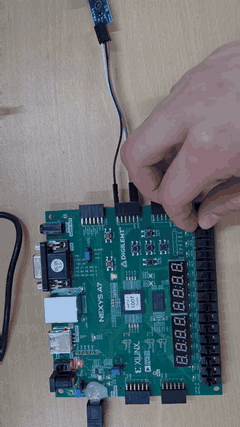
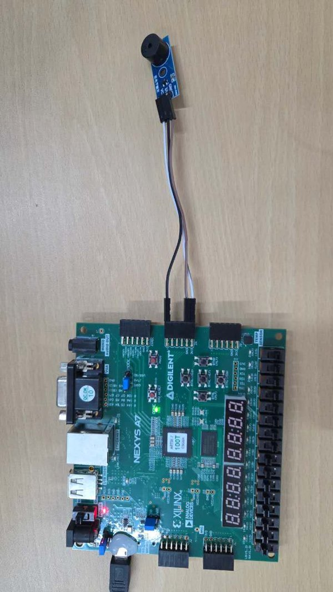
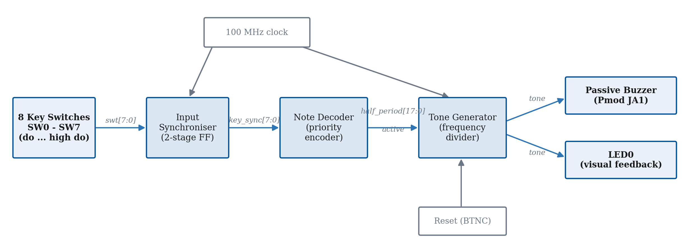
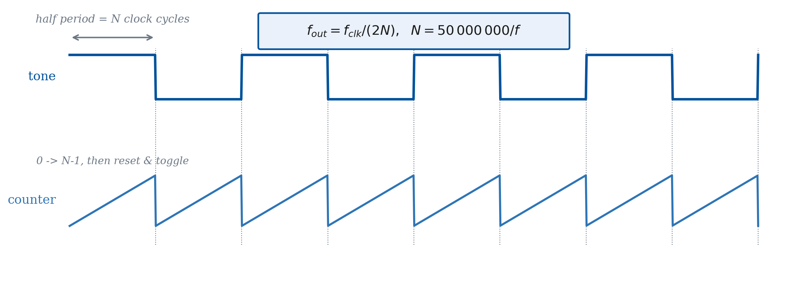
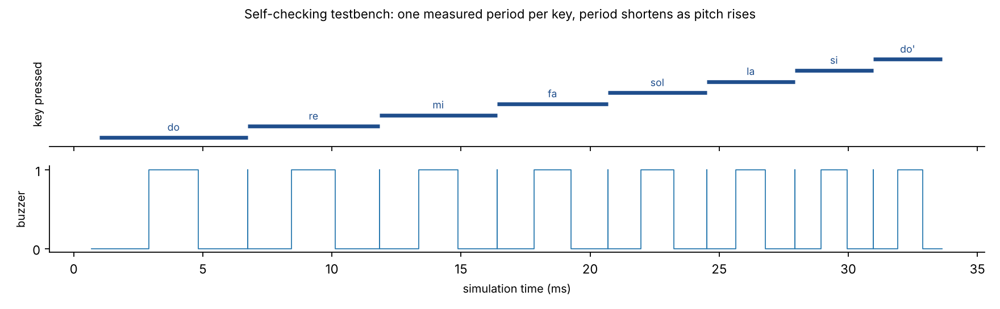

# 8-Note Electronic Piano on FPGA

An eight-key electronic piano written in Verilog and implemented on a Digilent Nexys A7 (Xilinx Artix-7). Each slide switch plays one note of the C-major octave, from C4 (261.63 Hz) to C5 (523.25 Hz). The tone is generated by digital frequency division of the 100 MHz board clock and drives a passive buzzer and an LED in sync.

Course project for *Electronic Technology Experiment (Digital Circuit Part)*, Tongji University, Shanghai, 2025/26.

Full design report: [docs/report_electronic_piano.pdf](docs/report_electronic_piano.pdf)

<p align="center">
  <a href="docs/media/piano_demo.mp4"></a>
  &nbsp;&nbsp;
  
</p>

<p align="center"><b><a href="docs/media/piano_demo.mp4">Watch the full hardware demo with sound (14 s)</a></b></p>

## Features

- 8 keys mapped to do, re, mi, fa, sol, la, si, high do
- Square-wave tones accurate to within 0.0004 % of the target pitch
- Passive buzzer and LED driven by the same signal, so they are always synchronous
- Silent, dark output when no key is pressed
- Two-flip-flop synchroniser on the asynchronous switch inputs
- Fixed-priority decoder: with several keys held, the lowest one sounds (monophonic)
- Self-checking testbench covering every requirement

## Architecture



| Module | File | Role |
|---|---|---|
| Input synchroniser | `src/piano_top.v` | Two register stages move `swt[7:0]` into the clock domain and remove metastability |
| Note decoder | `src/note_decoder.v` | Priority encoder that outputs the half-period count of the selected note and an `active` flag |
| Tone generator | `src/tone_generator.v` | Parameterised counter that toggles the output every N cycles; held at zero when idle |
| Output stage | `src/piano_top.v` | The same square wave drives the buzzer (Pmod JA1) and LED0 |

## Frequency division

A counter runs from 0 to N−1 and then toggles the output, so one full period lasts 2N clock cycles:

$$f_{out} = \frac{f_{clk}}{2N}, \qquad N = \mathrm{round}\left(\frac{f_{clk}}{2f}\right) = \mathrm{round}\left(\frac{50\,000\,000}{f}\right)$$



The largest count (C4, N = 191110) fits in an 18-bit counter.

| Switch | Note | Target (Hz) | N | Generated (Hz) | Error |
|---|---|---|---|---|---|
| SW0 | do (C4) | 261.63 | 191110 | 261.629 | −0.0002 % |
| SW1 | re (D4) | 293.66 | 170265 | 293.660 | 0.0000 % |
| SW2 | mi (E4) | 329.63 | 151685 | 329.630 | +0.0001 % |
| SW3 | fa (F4) | 349.23 | 143172 | 349.230 | +0.0001 % |
| SW4 | sol (G4) | 392.00 | 127551 | 392.000 | 0.0000 % |
| SW5 | la (A4) | 440.00 | 113636 | 440.001 | +0.0003 % |
| SW6 | si (B4) | 493.88 | 101239 | 493.881 | +0.0002 % |
| SW7 | high do (C5) | 523.25 | 95557 | 523.248 | −0.0004 % |

## Verification

`sim/piano_top_tb.v` is a self-checking testbench running at 100 MHz. It:

1. checks that the buzzer and LED stay low for 100 000 cycles with no key pressed;
2. presses each key, measures one output period between rising edges and compares the frequency with the target (±0.1 % tolerance);
3. holds do, sol and high do together and checks that do is selected;
4. asserts on every clock edge that the LED equals the buzzer.



```
Test 1 - silence with no key pressed:
  [PASS] buzzer and LED stayed low for 100000 cycles
Test 2 - tone frequency for each of the 8 keys:
  [PASS] key[0]: target  261.63 Hz, measured  261.63 Hz (period 3822200 ns)
  ...
  [PASS] key[7]: target  523.25 Hz, measured  523.25 Hz (period 1911140 ns)
Test 3 - priority when several keys are held (expect 'do'):
  [PASS] priority selected 'do' (261.63 Hz)
--------------------------------------------------
ALL TESTS PASSED
```

## Hardware

| Signal | Pin | Board resource |
|---|---|---|
| `clk` | E3 | 100 MHz oscillator |
| `rst` | N17 | BTNC (active high) |
| `swt[7:0]` | J15, L16, M13, R15, R17, T18, U18, R13 | SW0 to SW7 |
| `led` | H17 | LED0 |
| `buzzer` | C17 | Pmod JA1 |

The buzzer must be **passive**: an active buzzer has its own oscillator and ignores the input frequency. Because the notes are between 260 and 520 Hz, the LED appears as a steady glow rather than a visible blink.

## Running it

**Simulation** (Icarus Verilog):

```bash
make sim     # compile and run the testbench
make wave    # open the waveform in GTKWave
```

**FPGA** (Vivado): create an RTL project for `xc7a100tcsg324-1`, add the files in `src/` as design sources and `constraints/piano.xdc` as constraints, set `piano_top` as top, then run synthesis, implementation and bitstream generation and program the board.

## Repository structure

```
src/           RTL: top level, note decoder, tone generator
sim/           self-checking testbench
constraints/   Nexys A7 pin constraints (.xdc)
docs/          design report (PDF)
docs/images/   diagrams, simulation waveform, hardware photo
docs/media/    hardware demo video and preview
Makefile       simulation targets
```

## Tools

Verilog HDL · Xilinx Vivado · Digilent Nexys A7-100T

## Author

Camilla Malossi, Automation Engineering, University of Bologna (AlmaTong double degree programme with Tongji University)
